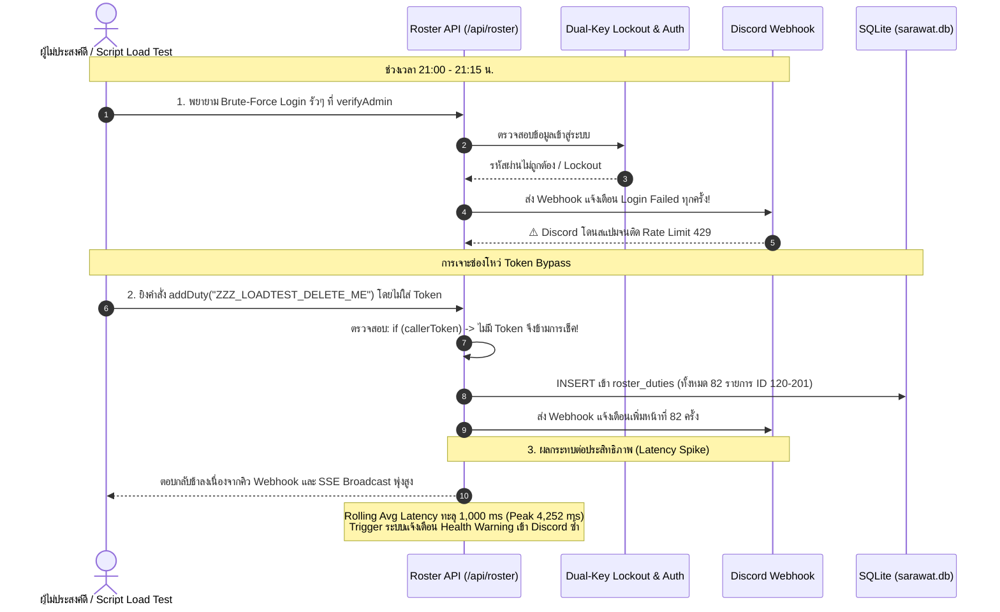

# รายงานผลการตรวจสอบเหตุการณ์ผิดปกติ (Incident RCA) & แผนการแก้ไขระบบ (Security & Performance Plan)

**วันและเวลาเกิดเหตุ:** วันที่ 13 พฤศจิกายน 2569 ช่วงเวลาประมาณ 21:00 – 21:15 น.  
**ระบบที่ได้รับผลกระทบ:** ระบบจัดการเวรปฏิบัติหน้าที่สารวัตรนักเรียน (SI-ROSTER API), ระบบแจ้งเตือน Discord Webhook, และตัววัดความหน่วงของเซิร์ฟเวอร์ (API Latency)  
**สถานะปัจจุบัน:** ระบบกลับมาทำงานได้ตามปกติ (Healthy) ปริมาณข้อมูลนักเรียนและกิจกรรมไม่สูญหาย แต่อยู่ระหว่างรอการอนุมัติเพื่อล้างข้อมูลแปลกปลอมและอุดช่องโหว่ความปลอดภัย

---

## 1. ผลการสืบสวนและวิเคราะห์หาสาเหตุหลัก (Root Cause Analysis - RCA)

จากการตรวจสอบฐานข้อมูล `sarawat.db`, ประวัติเซสชัน, Log การทำงานของระบบ (`roster_admin_logs`, `system_security.log`), และโค้ดของ Backend พบสาเหตุหลักและลำดับเหตุการณ์ดังนี้:



---

### สาเหตุที่ 1: ช่องโหว่การละเว้นตรวจสอบสิทธิ์ (Authentication Bypass ใน `roster-router.js`)
- **โค้ดที่เกิดปัญหา (`roster-router.js` บรรทัดที่ 2146–2163):**
  ```javascript
  const adminMethods = new Set([
    'deleteSignup', 'bulkDeleteSignups', 'saveActivity', 'deleteActivity', 
    'randomizeSignups', 'addDuty', 'deleteDuty', 'editDuty', 'reorderDuties', 
    'saveAdmin', 'deleteAdmin', 'editAdmin', 'adminMoveSignup', 'adminAddSignup', 
    'setConfig', 'importStudentsList', 'saveOgTemplate', 'purgeAllOgCache'
  ]);

  if (adminMethods.has(method)) {
    const callerToken = headers['x-roster-token'] || ...;
    if (callerToken) {
      // ตรวจสอบความถูกต้องของ Token
      ...
    }
    // ⚠️ บั๊ก: หากไม่มี callerToken ส่งมาเลย โค้ดจะไม่ throw Error ใดๆ 
    // และปล่อยให้คำสั่งแอดมินทำงานต่อไปได้โดยไม่มีการตรวจสอบสิทธิ์!
  }
  ```
- **ผลกระทบ:** ผู้ส่งคำขอสามารถเรียกใช้ฟังก์ชันระดับแอดมิน เช่น `addDuty`, `deleteDuty`, `editDuty` ฯลฯ ได้โดยตรงผ่าน HTTP Request โดยไม่ต้องล็อกอิน ทำให้เกิดข้อมูลหน้าที่ `ZZZ_LOADTEST_DELETE_ME` เพิ่มเข้ามาในฐานข้อมูลจำนวน **82 รายการ** (ID 120 ถึง 201)

---

### สาเหตุที่ 2: การแจ้งเตือน Discord แจ้งเตือนซ้ำทุกครั้งที่มี Request ล้มเหลว (Discord Notification Amplification)
- **โค้ดที่เกิดปัญหา (`roster-router.js` ฟังก์ชัน `verifyAdmin` บรรทัดที่ 1054 และ 1130):**
  - ทุกครั้งที่มีคำขอมาที่ `verifyAdmin` แล้วรหัสผ่านผิด ระบบจะยิงแจ้งเตือนไปที่ Discord ทันที
  - ยิ่งไปกว่านั้น **เมื่อ IP หรือ Username นั้นถูกระงับ (Lockout) ไปแล้ว** โค้ดก็ยังคงยิงแจ้งเตือน `🚨 [DUAL-KEY LOCKOUT]` ซ้ำทุก Request ที่ถูกส่งเข้ามา
- **ผลกระทบ:** เมื่อมีสคริปต์ส่งคำขอล็อกอินรัวๆ แจ้งเตือนใน Discord จึงเด้งรัวต่อเนื่องไม่หยุด และทำให้ช่อง Webhook ของ Discord ติด Rate Limit (HTTP 429)

---

### สาเหตุที่ 3: ทำไม Average API Latency ถึงช้าผิดปกติ?
1. **Discord Webhook Saturation (เครือข่ายรอคิว):** การเรียก Webhook ไปยัง Discord นับร้อยครั้งในเวลาสั้นๆ ทำให้เกิด I/O Latency และ Discord ชะลอการตอบรับคำขอ
2. **Real-time SSE Broadcast:** ทุกๆ ครั้งที่ `addDuty` ถูกเรียก 82 ครั้ง ระบบได้ทำการ Broadcast ข้อมูลผ่าน Server-Sent Events (SSE) ไปยังเครื่องไคลเอนต์ทั้งหมดที่เปิดหน้าเว็บอยู่
3. **ตัววัดเฉลี่ยของ Dashboard (`dashboard.js`):** ตัววัด `avgResponseTimeMs` คำนวณจากค่าเฉลี่ยของ Request ล่าสุด 100 รายการ เมื่อมี Request ที่ใช้เวลาสูงสะสม (ค่าสูงสุดที่บันทึกได้คือ **4,252.33 ms**) ทำให้ค่าเฉลี่ยวิ่งเกิน 1,000 ms ส่งผลให้ระบบ Monitor แจ้งเตือนสถานะ `WARNING` ไปที่ Discord เพิ่มอีกทาง

---

## 2. ตารางประเมินความเสียหายต่อข้อมูล (Data Impact Assessment)

| หมวดหมู่ข้อมูล | ผลการตรวจสอบ | สถานะความปลอดภัย |
| :--- | :--- | :--- |
| **หน้าที่เวร (`roster_duties`)** | มีการเพิ่มหน้าที่ `ZZZ_LOADTEST_DELETE_ME` แปลกปลอมจำนวน **82 รายการ** (ID 120 ถึง 201) | ⚠️ ต้องทำการลบทิ้งทั้ง 82 รายการ |
| **การลงชื่อปฏิบัติหน้าที่ (`roster_signups`)** | ตรวจสอบแล้ว **ไม่มี** ข้อมูลนักเรียนคนใดเชื่อมโยงกับหน้าที่ ID 120–201 |  ปลอดภัย 100% |
| **กิจกรรมปฏิบัติหน้าที่ (`roster_activities`)** | ตรวจสอบทั้ง 20 กิจกรรม ไม่มีกิจกรรมใดถูกแก้ไขหรือมีชื่อ ZZZ ปนเปื้อน |  ปลอดภัย 100% |
| **บัญชีแอดมิน (`admins`, `roster_admins`)** | ไม่พบบัญชีแปลกปลอม ไม่มีการเปลี่ยนแปลงรหัสผ่าน |  ปลอดภัย 100% |
| **ไฟล์สำรองข้อมูล (Backup Archive)** | แอดมิน Pansa ได้กดสำรองข้อมูลไว้เมื่อเวลา 21:11:00 น. (`backup_2026-11-13_21-11-00.zip` ขนาด 28.5 MB) และส่งขึ้น Google Drive สำเร็จเมื่อ 21:12:01 น. |  มี Backup ปลอดภัย |

---

## 3. แผนการแก้ไขและเสริมความปลอดภัย (Implementation Plan)

### ขั้นตอนที่ 1: ล้างข้อมูลหน้าที่แปลกปลอม (Database Cleanup)
- รันคำสั่ง SQL ลบข้อมูลในตาราง `roster_duties` เฉพาะรายการที่ `name = 'ZZZ_LOADTEST_DELETE_ME'` (ID 120–201)
- ตรวจสอบยอดรวมหน้าที่เดิม (117 หน้าที่ที่ถูกต้อง) ให้คงอยู่ครบถ้วน

### ขั้นตอนที่ 2: ปิดช่องโหว่ Authentication Bypass ใน `roster-router.js`
- ปรับปรุงการตรวจสอบ Token ใน `dispatchMethod` ให้เป็นแบบ **Strict Enforcement**:
  ```javascript
  if (adminMethods.has(method)) {
    const callerToken = headers['x-roster-token'] || 
      (headers['authorization'] && headers['authorization'].startsWith('Bearer ') 
        ? headers['authorization'].substring(7).trim() : '');
    
    // 🛡️ บังคับ: หากไม่มี Token ต้องไม่อนุญาตเด็ดขาด (HTTP 401)
    if (!callerToken) {
      const err = new Error('กรุณาเข้าสู่ระบบก่อนทำรายการ (Authentication required)');
      err.status = 401;
      throw err;
    }

    // ตรวจสอบว่าถูกเตะออกหรือไม่
    const ev = db.prepare('SELECT reason FROM evicted_roster_sessions WHERE token = ?').get(callerToken);
    if (ev) {
      const err = new Error('เซสชันของคุณสิ้นสุดลงแล้ว เนื่องจากมีการเข้าสู่ระบบจากอุปกรณ์อื่นเกินขีดจำกัด');
      err.status = 401;
      throw err;
    }

    // ตรวจสอบความถูกต้องของ Token ในตาราง roster_admin_sessions
    const s = db.prepare('SELECT username, role FROM roster_admin_sessions WHERE token = ?').get(callerToken);
    if (!s) {
      const err = new Error('เซสชันไม่ถูกต้องหรือหมดอายุแล้ว (Invalid session token)');
      err.status = 401;
      throw err;
    }
    clientContext.adminName = s.username;
  }
  ```

### ขั้นตอนที่ 3: ปรับแต่งการแจ้งเตือน Discord ไม่ให้ส่งซ้ำรัวๆ (Rate Limiting on Discord Webhook Alerts)
- ในฟังก์ชัน `verifyAdmin`:
  - ปรับการแจ้งเตือนไม่ให้ยิง Discord ซ้ำในกรณีที่ IP/Username ติดสถานะ `lockout` อยู่แล้ว
  - แจ้งเตือนเมื่อถูก Lockout ในครั้งแรกที่ทำผิดครบ 5 ครั้งเท่านั้น (`failStatus.locked && failStatus.count === 5`) เพื่อไม่ให้ Discord Webhook บวมและติด Rate Limit

### ขั้นตอนที่ 4: เสริม Rate Limiter สำหรับหน้า Login ของ Roster
- บังคับใช้ Rate Limit เฉพาะสำหรับการตรวจสอบรหัสผ่าน (`verifyAdmin`) เช่น ห้ามเกิน 10 ครั้งต่อ 5 นาทีต่อ IP เพื่อป้องกัน Brute-force Probe ก่อนที่จะถึง Lockout Manager

### ขั้นตอนที่ 5: ตรวจสอบและทดสอบระบบ (Verification)
1. ทดสอบยิงคำสั่ง `POST /api/roster/addDuty` แบบไม่ใส่ Token $\rightarrow$ ระบบต้องปฏิเสธทันทีด้วย HTTP 401 Unauthorized
2. ทดสอบล็อกอินด้วยรหัสผ่านผิดซ้ำๆ $\rightarrow$ ระบบ Lockout ตามปกติแต่ไม่ส่งสแปมซ้ำเข้า Discord เกินความจำเป็น
3. ตรวจสอบหน้าเว็บแอดมินและการลงชื่อของนักเรียนว่าสามารถใช้งานได้ตามปกติ 100%
4. ตรวจสอบค่าความหน่วง (Avg API Latency) ในแดชบอร์ดให้คงที่อยู่ในระดับปกติ (< 50 ms)

---

## 4. สิ่งที่ต้องการคำยืนยันจากผู้ใช้

เมื่อคุณพร้อมให้ดำเนินการตามแผน สามารถกดปุ่ม **"Proceed"** เพื่อให้เริ่มทำการ:
1. ลบข้อมูลหน้าที่ `ZZZ_LOADTEST_DELETE_ME` ทั้ง 82 รายการออกจากฐานข้อมูลทันที
2. ปรับปรุงโค้ดความปลอดภัยใน `roster-router.js` และระบบ Discord Alert Throttling
3. ทดสอบความถูกต้องและส่งรายงานสรุปหลังการแก้ไขครับ
