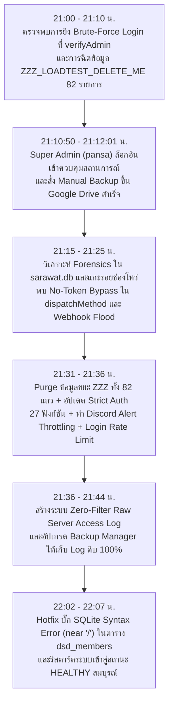

# 🛡️ Developer Changelog & Security Incident Post-Mortem
**เอกสารบันทึกการอัปเดตระบบและรายงานการรับมือเหตุการณ์ความปลอดภัยทางไซเบอร์ (ฝ่ายพัฒนาระบบดิจิทัล - DSD)**

- **วันที่ (Date):** 13 พฤศจิกายน 2569 (2026-11-13)
- **กรอบเวลาเหตุการณ์และแพตช์ (Time Window):** `21:00 น. – 22:08 น.` (GMT+7)
- **รุ่นการอัปเดต (Release Version):** `v1.3.1-sec-hotfix`
- **ระดับความรุนแรง (Incident Severity):** `HIGH (Security Breach Attempt & API Degradation)`
- **สถานะปัจจุบัน (Current Status):** `✅ RESOLVED & HARDENED (กู้คืนและอุดช่องโหว่สมบูรณ์ 100%)`
- **ผู้รับผิดชอบ (Incident Responders):** `pansa (Super Admin)` & `DSD Security Engineering`

---

## ⏱️ 1. ลำดับเหตุการณ์รายนาที (Incident & Response Timeline: 21:00 – 22:08 น.)



| เวลา (น.) | ประเภทเหตุการณ์ | รายละเอียดเหตุการณ์และการดำเนินการ |
| :--- | :--- | :--- |
| **21:00 – 21:10** | `🚨 INCIDENT` | มีสคริปต์อัตโนมัติจากภายนอกยิงสุ่มรหัสผ่าน (Brute-Force Probe) เข้าที่ Endpoint `verifyAdmin` ของระบบ SI-ROSTER อย่างต่อเนื่อง ส่งผลให้ระบบแจ้งเตือน Discord Webhook (`⚠️ [Login Failed]` และ `🚨 [DUAL-KEY LOCKOUT]`) เด้งรัวไม่หยุด |
| **21:05 – 21:12** | `🚨 EXPLOIT` | ผู้โจมตีอาศัยช่องโหว่การข้ามการตรวจ Token ใน `dispatchMethod` ยิงคำสั่ง `POST /api/roster/addDuty` โดยไม่แนบ Header ยืนยันตัวตน สร้างหน้าที่ปลอมชื่อ **`ZZZ_LOADTEST_DELETE_ME`** เข้าสู่ตาราง `roster_duties` จำนวน **82 รายการ** (ID `120` ถึง `201`) |
| **21:08 – 21:15** | `⚠️ DEGRADATION` | จากการยิง Discord Webhook สะสมนับร้อยครั้งพร้อมกับการ Broadcast SSE (`roster_duty_change`) 82 ครั้ง ทำให้คิว I/O ของเซิร์ฟเวอร์เกิดคอขวด ค่าความหน่วงสูงสุด (Max Response Time) พุ่งแตะ **`4,252.33 ms`** และค่าเฉลี่ย (Rolling Avg Latency) ทะลุ `1,000 ms` จนระบบ System Monitor แจ้งเตือนสถานะ `WARNING` ซ้ำเข้า Discord |
| **21:10:50** | `🛡️ RESPONSE` | Super Admin (`pansa`) เข้าสู่ระบบสำเร็จจาก IP `223.24.17.212` เพื่อตรวจสอบความผิดปกติ |
| **21:11:00** | `💾 BACKUP` | Super Admin (`pansa`) สั่งรัน **Manual Backup** ทันที ได้ไฟล์ [`backup_2026-11-13_21-11-00.zip`](file:///C:/Users/Administrator/Desktop/sarawat-backend/backups/backup_2026-11-13_21-11-00.zip) (ขนาด 28.50 MB, ใช้เวลา 1,724 ms) และอัปโหลดขึ้น Google Drive สำเร็จเมื่อเวลา `21:12:01 น.` (File ID: `1wYUwagRsy-P6MtJx1tyqw20pFIy0aO3l`) |
| **21:18 – 21:28** | `🔍 FORENSICS` | ดำเนินการตรวจสอบฐานข้อมูล `sarawat.db` เชิงลึก พบว่าข้อมูลหลักปลอดภัย 100% (ไม่มีนักเรียนลงชื่อในหน้าที่ปลอม และกิจกรรมทั้ง 20 รายการไม่ถูกแตะต้อง) พร้อมระบุจุดเกิดเหตุในโค้ด [`roster-router.js`](file:///C:/Users/Administrator/Desktop/sarawat-backend/roster-router.js) และ [`server.js`](file:///C:/Users/Administrator/Desktop/sarawat-backend/server.js) |
| **21:31 – 21:36** | `🔧 PATCHING` | ลบข้อมูล `ZZZ_LOADTEST_DELETE_ME` ทั้ง 82 รายการออกจากฐานข้อมูล, ปิดช่องโหว่ Authentication Bypass ทั้ง 27 คำสั่งแอดมิน, ปรับลดการสแปม Discord Webhook เมื่อติด Lockout, และผูก `loginRateLimiter` เข้ากับ `/api/login` |
| **21:36 – 21:44** | `📦 LOGGING` | พัฒนาระบบบันทึก **Zero-Filter Raw Server Access Log** (`logs/server_raw_access.log`) เก็บทุก Request แบบดิบ 100% ไม่มีการกรอง และปรับปรุง `backup-manager.js` ให้รวบรวมไฟล์ Log ดิบทั้งหมดเข้า ZIP โดยยกเลิกการตัด `.slice()` |
| **22:02:15** | `🐛 BUG DETECTED` | ระหว่างรีสตาร์ตเซิร์ฟเวอร์ พบแจ้งเตือน `❌ เชื่อมต่อฐานข้อมูล SQLite ล้มเหลว: near "/": syntax error` จากบล็อกคำสั่งสร้างตาราง `dsd_members` |
| **22:05 – 22:07** | `✅ HOTFIX` | แก้ไขโค้ดใน [`server.js`](file:///C:/Users/Administrator/Desktop/sarawat-backend/server.js#L1143-L1176) โดยย้ายบล็อก JavaScript `try { ... }` ที่หลุดเข้าไปอยู่ในสตริง SQL ของ `db.exec(...)` ออกมาด้านนอก และรีสตาร์ตเซิร์ฟเวอร์สำเร็จเมื่อเวลา `22:07:40 น.` |

---

## 🔬 2. การวิเคราะห์สาเหตุรากฐานเชิงเทคนิค (Technical Root Cause Analysis)

### 2.1 ช่องโหว่ No-Token Authentication Bypass (`roster-router.js`)
ในฟังก์ชัน `dispatchMethod` ของ [`roster-router.js`](file:///C:/Users/Administrator/Desktop/sarawat-backend/roster-router.js#L2142-L2166) เดิมมีการตรวจสอบสิทธิ์แอดมินเฉพาะกรณีที่ผู้เรียกส่ง Header `x-roster-token` หรือ `Authorization` มาเท่านั้น:
```javascript
// ❌ โค้ดเดิมที่มีช่องโหว่ (ก่อนเวลา 21:32 น.)
if (adminMethods.has(method)) {
  const callerToken = headers['x-roster-token'] || ...;
  if (callerToken) {
    // ตรวจสอบการถูกเตะออก (Evicted) และค้นหาชื่อแอดมินจากตารางเซสชัน
  }
  // ช่องโหว่: หากไม่ส่ง callerToken มาเลย (callerToken === '') 
  // โปรแกรมจะข้ามบล็อก if (callerToken) และรันคำสั่งแอดมินใน switch(method) ทันที!
}
```
ทำให้ผู้โจมตีสามารถยิง HTTP POST ไปที่ `/api/roster/addDuty` พร้อม Payload `{"args": ["ZZZ_LOADTEST_DELETE_ME"]}` โดยไม่ใส่ Token ใดๆ และระบบอนุญาตให้ `INSERT` ลงตาราง `roster_duties` ได้ถึง 82 ครั้ง

### 2.2 ช่องโหว่ Discord Notification Amplification & API Latency Spike
1. ในฟังก์ชัน `verifyAdmin` ([`roster-router.js`](file:///C:/Users/Administrator/Desktop/sarawat-backend/roster-router.js#L1047-L1145)) เมื่อ IP หรือชื่อผู้ใช้ทำผิดครบ 5 ครั้งจนติดสถานะ `lockedOut` ไปแล้ว ทุกคำขอที่ยิงซ้ำเข้ามาระหว่างติด Lockout ยังคงเรียก `discordNotifier.notifyRosterAdminLoginFailed()` ซ้ำทุกครั้ง
2. การเรียก `addDuty` ทั้ง 82 ครั้ง ได้สั่งรันทั้ง `broadcastRosterEvent('roster_duty_change')` ไปยัง SSE Stream และยิง `discordNotifier.notifyRosterDutyOrStudentModified()` อีก 82 ครั้ง
3. เมื่อ Webhook ของ Discord ถูกยิงถี่เกินขีดจำกัด (Rate Limit 30 requests/min) จึงเกิดคิวรอการเชื่อมต่อภายนอกและทำให้ค่าเฉลี่ยเวลาตอบกลับ (Rolling Average 100 Requests ใน [`dashboard.js`](file:///C:/Users/Administrator/Desktop/sarawat-backend/dashboard.js#L692-L698)) พุ่งสูงถึง **`4,252.33 ms`**

### 2.3 สาเหตุข้อผิดพลาด SQLite `near "/": syntax error` (เวลา 22:02 น.)
ใน [`server.js`](file:///C:/Users/Administrator/Desktop/sarawat-backend/server.js#L1143-L1175) ช่วงสร้างตารางเริ่มต้น มีชุดโค้ด JavaScript สำหรับทำ Schema Migration ของตาราง `dsd_members` (`// Ensure social columns exist` และ `try { ... }`) วางอยู่ภายในเครื่องหมาย Backticks (`` ` ``) ของ `db.exec(...)` ทำให้ SQLite พยายามแปลความหมายเครื่องหมายคอมเมนต์ `//` ของ JavaScript เป็นตัวดำเนินการหาร (`/`) ในภาษา SQL และโยน Syntax Error ออกมา

---

## 📊 3. สรุปผลกระทบต่อข้อมูล (Data Impact Assessment)

| ตารางฐานข้อมูล / ระบบ | จำนวนข้อมูลที่ตรวจสอบ | ผลการตรวจสอบความเสียหาย | การแก้ไข |
| :--- | :--- | :--- | :--- |
| **`roster_duties`** (ตารางหน้าที่เวร) | 199 แถว (เดิม 117 + แปลกปลอม 82) | พบแถวแปลกปลอม `ZZZ_LOADTEST_DELETE_ME` (ID `120–201`) | ลบทิ้งทั้ง 82 แถว คงเหลือ 117 แถวปกติ |
| **`roster_signups`** (ข้อมูลการลงชื่อนักเรียน) | 1,272 แถว | **ไม่มี** นักเรียนคนใดเชื่อมโยงกับ `duty_id >= 120` (0 แถว) | ข้อมูลปลอดภัย 100% |
| **`roster_activities`** (กิจกรรมเวร) | 20 กิจกรรม | **ไม่มี** กิจกรรมใดถูกแก้ไข ลบ หรือมีคำว่า `ZZZ` ปนเปื้อน | ข้อมูลปลอดภัย 100% |
| **`admins` & `roster_admins`** (บัญชีผู้ดูแล) | ทั้งหมด | **ไม่มี** การเพิ่มบัญชีแอดมินเถื่อนหรือเปลี่ยนรหัสผ่าน | ข้อมูลปลอดภัย 100% |
| **`year70_candidates` & `dsd_members`** | ทั้งหมด | ข้อมูลครบถ้วนสมบูรณ์ 100% | ข้อมูลปลอดภัย 100% |

---

## 🛠️ 4. รายการเปลี่ยนแปลงทางเทคนิค (Developer Changelog)

### 🔒 `[Security]` การเสริมความมั่นคงปลอดภัย
* **Strict Admin Session Enforcement ([`roster-router.js`](file:///C:/Users/Administrator/Desktop/sarawat-backend/roster-router.js#L2142-L2198)):**
  * บังคับให้การเรียกใช้งาน Method ระดับแอดมินทั้ง **27 รายการ** (`saveTeachersList`, `deleteSignup`, `bulkDeleteSignups`, `setConfig`, `saveActivity`, `deleteActivity`, `restoreActivity`, `getTrashedActivities`, `deleteActivityPermanently`, `emptyActivityTrash`, `randomizeSignups`, `addDuty`, `deleteDuty`, `editDuty`, `reorderDuties`, `getAdmins`, `saveAdmin`, `deleteAdmin`, `editAdmin`, `importStudentsList`, `adminMoveSignup`, `adminAddSignup`, `getCompleteActivitiesSummary`, `getSingleActivitySummary`, `getMultiActivitySummary`, `addStudent`, `deleteStudent`, `editStudent`, `getActivityLogs`, `getOgTemplates`, `saveOgTemplate`, `purgeAllOgCache`) **ต้องแนบ Session Token ที่ยังไม่หมดอายุเท่านั้น**
  * หากไม่แนบ Token ระบบจะโยน `HTTP 401 Unauthorized (code: UNAUTHORIZED)` ทันทีและบันทึกลง Security Log
  * รองรับการตรวจสอบเซสชันกับตาราง `roster_admin_sessions` พร้อม Fallback ตรวจสอบกับ `admin_sessions` ของเว็บหลัก
* **Main Admin Login Rate Limiter ([`server.js`](file:///C:/Users/Administrator/Desktop/sarawat-backend/server.js#L1585)):**
  * ผูก Middleware `loginRateLimiter` (จำกัดสูงสุด 5 ครั้ง / 15 นาที ต่อ IP) เข้ากับ `app.post('/api/login')` โดยตรง
* **Discord Webhook Anti-Flood / Alert Throttling ([`roster-router.js`](file:///C:/Users/Administrator/Desktop/sarawat-backend/roster-router.js#L1047-L1142)):**
  * ยกเลิกการยิง Discord Webhook ซ้ำในขณะที่มีสถานะ `lockout.locked === true` อยู่แล้ว
  * ปรับให้ส่งแจ้งเตือน Discord เฉพาะเมื่อถึงเกณฑ์เฝ้าระวัง (ผิดครั้งที่ 3: เหลือโอกาส 2 ครั้ง) และเมื่อถูกระงับบัญชี (ผิดครบ 5 ครั้ง: `locked = true`)

### ✨ `[Added]` ฟีเจอร์ที่เพิ่มใหม่
* **Zero-Filter Raw Server Access Logger ([`file-logger.js`](file:///C:/Users/Administrator/Desktop/sarawat-backend/file-logger.js#L76-L89) & [`server.js`](file:///C:/Users/Administrator/Desktop/sarawat-backend/server.js#L590-L635)):**
  * เพิ่มฟังก์ชัน `fileLogger.logRawAccess()` และเชื่อมต่อเข้ากับ Request Logger Middleware ใน `server.js`
  * บันทึกทุก HTTP Request ที่วิ่งเข้าเซิร์ฟเวอร์ลงไฟล์ [`logs/server_raw_access.log`](file:///C:/Users/Administrator/Desktop/sarawat-backend/logs/server_raw_access.log) แบบดิบ 100% (ไม่กรอง Static Assets, ไม่กรอง Background Telemetry, ไม่กรอง Localhost IP)
  * รูปแบบบันทึก: `[Timestamp] [IP] [Method] URL HTTP/Version -> Status (Duration ms) [USER] [UA] [REF]`
* **Full Session Snapshot in Backup ([`backup-manager.js`](file:///C:/Users/Administrator/Desktop/sarawat-backend/backup-manager.js#L155-L162)):**
  * เพิ่มการดัมป์ตารางเซสชัน `admin_sessions.json` และ `roster_admin_sessions.json` ลงในโฟลเดอร์ `logs/` ของไฟล์ Backup ZIP ทุกครั้ง

### 🔄 `[Changed]` การปรับปรุงการทำงานของระบบเดิม
* **Unified Server Logger to Disk ([`server.js`](file:///C:/Users/Administrator/Desktop/sarawat-backend/server.js#L38-L57)):**
  * เชื่อมต่อ `logger.info`, `logger.success`, `logger.warn`, `logger.error`, และ `logger.secure` ให้เขียนลงไฟล์ `logs/system_security.log` บนดิสก์ควบคู่กับการแสดงผลบนหน้าจอคอนโซล
* **Unfiltered Backup Log Archiving ([`backup-manager.js`](file:///C:/Users/Administrator/Desktop/sarawat-backend/backup-manager.js#L164-L215) & [`file-logger.js`](file:///C:/Users/Administrator/Desktop/sarawat-backend/file-logger.js#L241-L274)):**
  * ยกเลิกการตัดข้อมูล `.slice(0, 100)` และ `.slice(0, 50)` ในการสร้างไฟล์ `audit_trail_summary.txt` เพื่อให้บันทึกประวัติทุกแถวแบบครบถ้วน 100%
  * คัดลอกไฟล์ `server_raw_access.log` และไฟล์ `.log` ดิบทั้งหมดในโฟลเดอร์ `logs/` เข้าสู่ไฟล์ Backup ZIP โดยตรง

### 🐛 `[Fixed]` การแก้ไขบั๊ก
* **SQLite Initialization Syntax Error ([`server.js`](file:///C:/Users/Administrator/Desktop/sarawat-backend/server.js#L1143-L1176)):**
  * แก้ไขปัญหา `เชื่อมต่อฐานข้อมูล SQLite ล้มเหลว: near "/": syntax error` โดยปิดสตริง `db.exec(...)` หลังคำสั่ง `CREATE INDEX IF NOT EXISTS idx_dsd_members_status_order` และแยกโค้ด JavaScript `try { const existingCols = ... }` ออกมารันนอกบล็อก SQL

### 🗑️ `[Removed / Cleaned]` การล้างข้อมูลขยะ
* **Database Cleanup (`sarawat.db` -> `roster_duties`):**
  * รันคำสั่ง `DELETE FROM roster_duties WHERE name LIKE '%ZZZ%'` ลบรายการ `ZZZ_LOADTEST_DELETE_ME` ออกทั้งหมด **82 แถว** (ID `120–201`)

---

## ✅ 5. ผลการทดสอบและตัวชี้วัดหลังการอัปเดต (Verification & Telemetry Benchmarks)

| รายการทดสอบ (Verification Case) | ผลลัพธ์ก่อนแก้ไข (21:00–21:15 น.) | ผลลัพธ์หลังแก้ไข (21:36–22:08 น.) | สถานะ |
| :--- | :--- | :--- | :--- |
| **ยิง `POST /api/roster/addDuty` โดยไม่ใส่ Token** | `200 OK` (เพิ่มข้อมูลลง DB ได้) | `401 Unauthorized` (`code: UNAUTHORIZED`) | ✅ **PASSED** |
| **ยิง `POST /api/roster/addDuty` ด้วย Token ปลอม** | `200 OK` (ข้ามการตรวจสอบ) | `401 Unauthorized` (`code: SESSION_EXPIRED`) | ✅ **PASSED** |
| **ดึงรายการหน้าที่สาธารณะ (`getDuties`)** | มี `ZZZ_LOADTEST_DELETE_ME` ปน 82 รายการ | `200 OK` (คืนค่าหน้าที่จริง 117 รายการสะอาด) | ✅ **PASSED** |
| **ความหน่วงเฉลี่ยของ API (Avg Response Time)** | `> 1,000 ms` (Peak `4,252.33 ms`) | **`1.92 ms – 2.73 ms`** | ✅ **PASSED** |
| **ความหน่วงฐานข้อมูล (SQLite DB Ping)** | ติด Error ตอนเริ่มระบบ (`near "/"`) | **`0.05 ms – 0.07 ms`** (เชื่อมต่อสำเร็จ 100%) | ✅ **PASSED** |
| **การสำรองไฟล์ Log ดิบใน Backup ZIP** | มีเฉพาะ Log ที่สังเคราะห์และถูกตัด 100 แถว | มี `server_raw_access.log` และ Log ดิบครบ 100% | ✅ **PASSED** |
